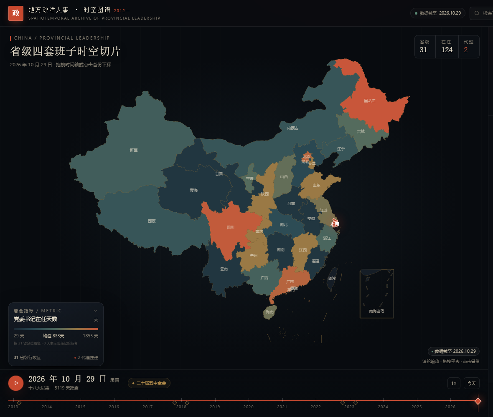
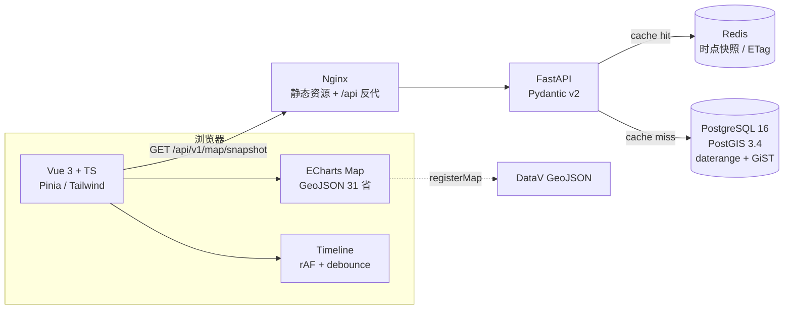

# 中国政治人事 · 时空图谱

> 2012 年以来的中国政治人事时空可视化系统  
> A spatiotemporal archive of Chinese political leadership, 2012 – present.

在地图与时间轴上检索省级四套班子，在机构信息抽屉中查看党中央机构、领导班子和中央委员会名单，并穿透到官员档案、席位沿革与任职履历。

当前版本：**v1.0.1**



> README 仅使用不含人员姓名的地图总览图，避免展示敏感人员信息。

## 当前版本重点

### 中央机构信息

- 机构详情使用独立右侧抽屉，支持滑入动画、地图背景模糊、遮罩与 Esc 关闭。
- 机构信息按「概况 / 领导班子 / 中央委员会名单 / 下属机构」组织。
- 党中央机构按以下层级展示：

```text
组成人员
领导人员
常设机构
工作机构
职能部门
纪律检查机关
办事机构
派出机关
直属事业单位
直属机关下属机构
```

- 机构卡片展示一中全会选举结果，并保留后续除名、增选记录。
- 被除名成员显示中划线和暗色文字；新增选成员显示「新增选」标签。
- 机构卡片右侧显示当前人数，数字与「人」使用统一字体和颜色。
- 中央政治局、政治局常委会、中央书记处均使用同一套机构信息抽屉。

### 中央委员会名单

- 时间敏感统计：

```text
中央委员：
初始 − 离任 + 递补 = 现任
现任 − 审查中 = 可出席

中央候补委员：
初始 − 离任 − 被递补 = 现任
现任 − 审查中 = 可出席
```

- 三级筛选：

```text
一级：全部 / 中央委员 / 中央候补委员
二级：初始 / 在任 / 已离任 / 审查中
三级：被开除 / 被撤职 / 辞职 / 逝世
```

- 支持按姓名、出生年、籍贯、身份、递补、状态排序。
- 表头冻结、滚动条可见、长字段悬浮查看完整内容。
- 支持浮窗阅览，浮窗内采用左侧筛选、右侧阅读区。
- 名单收录与政治统计分开显示，避免把补录进度当成现任人数。

### 省级人事

- 31 个省级行政区四套班子时点快照。
- 地图 × 时间轴联动；拖动时间轴刷新班子切片。
- 官员档案、跨省/跨部门履历甘特图、席位历任、空档与离任原因。
- 全国官员名册、筛选、CSV 导出。
- 数据覆盖报告区分「未收录」与「真实空缺」。

## 统一机构接口

中央机构已接入统一接口：

```text
GET /api/v1/institutions/{entity_type}/{institution_id}?date=YYYY-MM-DD
```

当前支持：

```text
central
```

以下路径已预留，地方适配器尚未接入：

```text
province
prefecture
county
subordinate
```

机构响应包含：

```text
schema_version
entity_type
sections
leaders
elected_members
roster_members
composition
membership_changes
```

前端根据 `sections[].available` 显示分区，不根据中央/地方写死分支。

接口契约见 [docs/institution-detail-contract.md](docs/institution-detail-contract.md)。

## 架构



- **时态模型**：一条 `tenure` = 一人一岗一段连续任职；所有「某日谁在任」都落到时点查询。
- **代理、兼任独立标记**：`is_acting`、`is_concurrent` 不污染正式任职。
- **读多写少**：读路径使用缓存与 ETag；写路径保留变更审计。
- **数据与呈现分离**：开除、增选、成员人数、机构分组尽量由后端返回，前端只负责渲染。

## 快速开始

### 方式一：本地开发（零数据库）

后端默认使用仓库内置 JSON 数据集，无需 PostgreSQL/Redis。

```bash
# 后端
python -m venv .venv
.venv\Scripts\activate            # macOS/Linux: source .venv/bin/activate
pip install -r backend/requirements.txt
cd backend
uvicorn app.main:app --reload --port 8000
```

```bash
# 前端（另开终端）
cd frontend
pnpm install
pnpm dev
```

打开：

```text
http://127.0.0.1:5173
```

Vite 将 `/api` 代理到 `127.0.0.1:8000`。

### 方式二：Docker 全栈

```bash
cp .env.example .env          # 修改 POSTGRES_PASSWORD
docker compose up --build
```

- Web：<http://localhost:8080>
- API 文档：<http://localhost:8000/docs>
- PostGIS：`localhost:5432/polvis`

首次启动会执行 `infra/initdb/` 下的建表、种子与边界 SQL。

## 测试与校验

```bash
# 数据校验
python scripts/validate_all.py

# 后端测试
cd backend && pytest -q

# 前端构建
cd frontend && pnpm build
```

当前基线：

```text
backend tests: 44 passed
schema_errors: 0
dataset problems: 0
central problems: 0
frontend build: successful
```

## API 一览

| Method | Path | 说明 |
| --- | --- | --- |
| GET | `/api/v1/meta` | 数据集、分类、指标、时间轴节点 |
| GET | `/api/v1/map/snapshot?date=` | 31 省四套班子时点快照 |
| GET | `/api/v1/regions/{code}/leaders?date=` | 单省详情 |
| GET | `/api/v1/regions/{code}/timeline` | 省级席位更替 |
| GET | `/api/v1/officers?q=` | 官员检索 |
| GET | `/api/v1/officers/{id}?date=` | 官员档案 |
| GET | `/api/v1/officers/{id}/career` | 履历甘特图数据 |
| GET | `/api/v1/directory` | 官员名册 |
| GET | `/api/v1/coverage` | 数据覆盖与缺口 |
| GET | `/api/v1/institutions/{entity_type}/{id}?date=` | 统一机构详情 |
| GET | `/api/v1/central/org?team=party&date=` | 中央机构组织架构 |
| GET | `/api/v1/central/committee?name=&date=` | 官员中央委员身份 |
| GET | `/api/v1/health` | 仓储与缓存状态 |

完整契约见 [docs/api.md](docs/api.md)。

## 数据范围

当前内置数据：

```text
officers：955
positions：357
tenures：1528
identities：161
organizations：260
```

- 覆盖 `2012-11-08` 至 `2026-10-29`。
- 中央机构第一版以二十届中央委员会、政治局常委会、政治局、中央书记处为重点。
- 部分人员缺少性别、民族、入党时间，页面显示「—」，不做推测填充。
- 部分机构正职仍在补录，页面不伪造空缺结论。
- 地方机构适配器尚未接入，省级、地级、县级页面仍使用现有省级模块。
- 十八届、十九届中央委员会尚未套用完整口径。

数据规则见：

- [数据治理](docs/data-governance.md)
- [数据写入规则](docs/data-write-rules.md)
- [二十届中央委员会基线](docs/central-committee-baseline.md)

## 目录结构

```text
.
├─ backend/                 FastAPI + Pydantic v2 + SQLAlchemy/psycopg
│  ├─ app/                  api / services / repositories / domain
│  ├─ app/data/             dataset.json / central.json / vocabulary.json
│  └─ tests/                API 与数据契约测试
├─ frontend/                Vue 3 + TS + Pinia + Tailwind + ECharts
│  ├─ src/components/       map / timeline / panel / institution / drawers
│  ├─ src/stores/           timeline / map / app / central
│  └─ public/geo/           31 省 GeoJSON
├─ infra/initdb/            DDL + 种子 SQL + PostGIS 边界
├─ scripts/                 数据构建、导入、校验脚本
├─ docs/                    架构 / API / 数据 / 版本 / 路线图
├─ CHANGELOG.md             版本日志
└─ docker-compose.yml
```

## 版本与后续计划

- [版本日志](CHANGELOG.md)
- [下一阶段开发计划](docs/next-development-plan.md)
- [开发路线图](docs/roadmap.md)
- [机构信息接口契约](docs/institution-detail-contract.md)

下一阶段优先级：

1. 补齐中央机构正职、人员字段和来源；
2. 接入省级机构适配器，复用同一机构信息抽屉；
3. 增加机构沿革 Tab；
4. 扩展地级、县级机构；
5. 再评估十八届、十九届中央委员会。

## 技术栈

Vue 3.5 · TypeScript · Pinia · TailwindCSS 3.4 · ECharts 5.6 · VueUse · FastAPI · Pydantic v2 · PostgreSQL 16 · PostGIS 3.4 · Redis 7 · Docker Compose

## 免责声明

本项目仅用于技术研究与数据可视化演示，不构成对任何个人任职状态的权威认定。历史人事信息以官方发布为准；如数据权利人对内容有异议，请联系删除。
