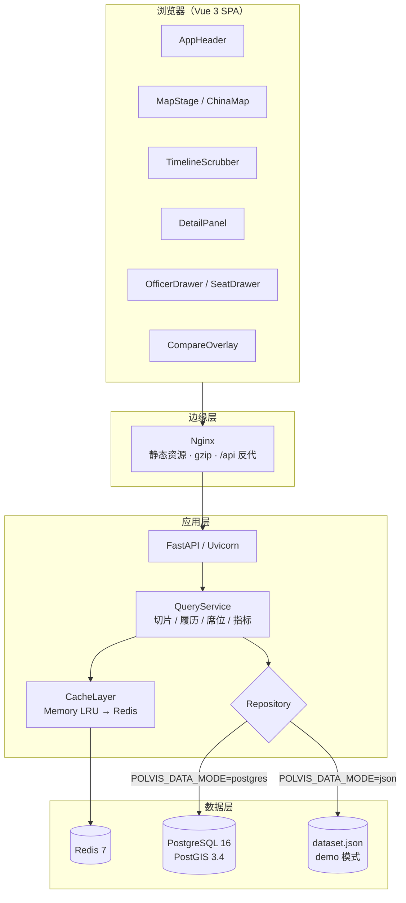
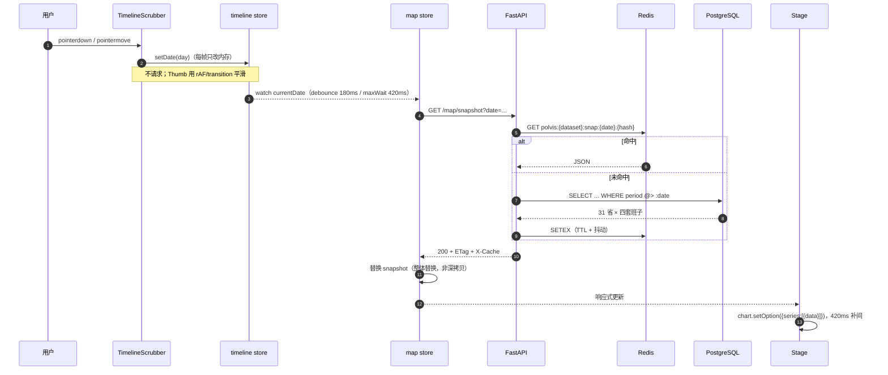
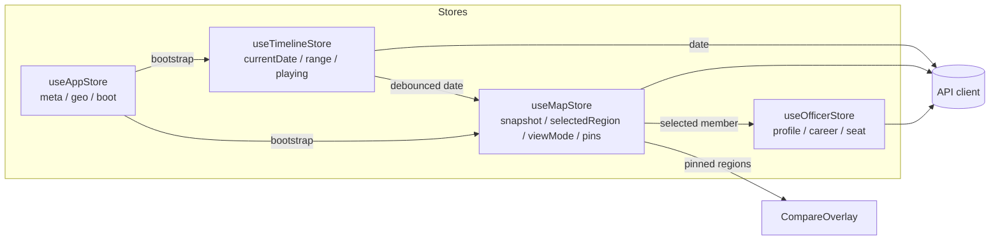

# 系统架构

## 1. 目标与约束

**目标**：给定任意 `as_of` 日期（2012-11-08 起），在 100ms 级返回 31 个省级行政区四套班子主官切片；支持从省 → 席位 → 个人 → 跨省履历的逐层穿透。

**非目标（当前版本）**：地级市完整数据、中央部委全量履历、实时新闻抓取、用户账号体系。

**硬约束**：

1. 政治类数据必须可追溯、可修订、可回滚，不能“猜测补全”。
2. 时间语义必须唯一：一次查询只对应一个 `as_of`，代理/兼任不能被折叠成普通任职。
3. 交互必须流畅：拖动时间轴时不能每个 `pointermove` 都发请求或重绘地图。

## 2. 总体架构



- **同构读模型**：`JsonRepository` 与 `SqlRepository` 实现同一 `Repository` 协议，API/Service 对存储无感知。Demo 模式零依赖启动；生产模式走 PostGIS。
- **缓存不是事实源**：Redis 只存序列化后的响应切片，key 含数据集版本；发布新版本时自然失效，不需要逐条删除。
- **前端不做业务聚合**：面板所需的四套班子、任职时长、代理标记、班子完整度均由 API 算好，前端只做展示与交互。

## 3. 读路径：拖动时间轴



关键点：

1. **指针帧与请求解耦**：`pointermove` 只更新 Pinia 的 `currentDate`，不触发请求。请求由 `useSnapshotSync` 的 debounce 触发；连续拖动时 `maxWait=420ms` 保证地图不会“冻住”。
2. **过期请求取消**：`map.loadSnapshot` 内部 `AbortController.abort()` 上一个请求，并用单调递增 `requestSeq` 丢弃乱序响应。
3. **ETag/304**：`/api/v1/map/snapshot` 返回强 ETag；前端按日期缓存 `{data, etag}`，重复访问同一日期最多传 304。
4. **地图只更新数据**：`ChinaMap` 首次 `setOption` 后只更新 `series[0].data`，避免重建 geo 组件导致闪烁。
5. **平滑补间**：点击事件/“今天”时 `timeline.animateTo` 用 `requestAnimationFrame` + easeOutCubic 在 480–700ms 内插值日期，产生“时间流动”的视觉，而不是瞬跳。

## 4. 前端状态架构



- **`currentDate` 单一事实源**：只存在 timeline store；任何组件不得持有自己的日期副本。
- **`viewMode` / `metric` / `pins` 持久化**：通过 VueUse `useStorage` 写入 localStorage；URL 同步 `date / region / view`，刷新可恢复。
- **选择省份不触发新请求**：地图快照一次返回 31 省，点击只是切换 `selectedRegionCode`，右侧立即渲染（无需 loading）。
- **Officer / Seat 互斥**：打开官员档案会关闭席位抽屉，避免两个遮罩层叠加。

组件树：

```
App.vue
├─ AppHeader (brand / search / view switch / help)
├─ main
│  ├─ MapStage
│  │  ├─ ChinaMap          ECharts map + markPoint + tooltip
│  │  ├─ MapLegend         指标切换 / 分位图例
│  │  └─ TimelineScrubber  播放 / 拖拽 / 事件标记
│  └─ DetailPanel          sidebar | floating | fullscreen
│     └─ RegionDetail
│        ├─ TeamSection × 4 → LeaderRow
│        ├─ ProvinceTimeline（仅 fullscreen）
│        └─ CompareTray
├─ OfficerDrawer → CareerGantt
├─ SeatDrawer
├─ CompareOverlay
├─ DirectoryView        与数据库同源的官员名册 + 覆盖看板
├─ SearchPalette / HelpDialog
└─ Boot overlay
```

三视图不是三套内容，而是**同一个 `RegionDetail` 的外壳切换**：

| 模式 | 定位 | 布局 |
| --- | --- | --- |
| sidebar | `relative`（桌面）/ `fixed`（移动） | 单列手风琴，宽 432px |
| floating | `fixed` + 指针拖拽 + 视口钳制 | 单列，max-height 受时间轴让位 |
| fullscreen | `fixed inset-x-0 top-16` | 头部大字号 + 2×2 班子 + 席位更替条带 |

好处：切换视图不卸载内容、不丢滚动位置、不重复请求；只有 CSS 定位与网格列数变化。

## 5. 后端分层

```
api/v1.py            路由、参数校验、ETag/304、HTTP 语义
services/query.py    业务编排：切片聚合、任期计算、指标、甘特分轨、缓存 key
repositories/        JSON / PostgreSQL 两种实现，返回统一 domain 对象
domain.py            Tenure / Officer / Region 数据类与日期/时长规则
core/cache.py        Memory LRU + Redis 两级缓存与降级
```

**为什么 Service 层不直接返回 ORM 行**：API 的响应形状（团队分组、`headline`、`metrics`、`lanes`）是产品语义，不是表结构；放在 Service 层可以保证两种 Repository 输出完全一致，也方便未来换存储。

## 6. 关键设计决策

| 决策 | 选择 | 理由 / 代价 |
| --- | --- | --- |
| 时态建模 | 区间事实 + `daterange` 生成列 | 时点查询一条 SQL；代价是写入时必须保证区间不重叠 |
| 代理任职 | 独立记录 + `is_acting` | 保留“代省长”历史；展示时与正式记录并列 |
| 兼任 | `is_concurrent` | 省委书记兼人大主任不被误判为两次任职 |
| 席位 | `positions` 注册表 | 岗位名称可随机构改革变化，历史记录保留 title 快照 |
| 缓存 | 响应级缓存，key 含 dataset version | 实现简单、可直接 304；代价是数据修订后按版本整体失效 |
| 地图 | ECharts `map` series + GeoJSON | 体积小、交互够用；大规模 POI 再引入 Mapbox GL |
| 甘特 | 手写 CSS/SVG 布局 | 无额外依赖、完全可控；复杂缩放/虚拟滚动后续再引入 D3 |
| Demo 数据 | 内置 JSON + 明确 disclaimer | 零门槛体验与测试；绝不冒充权威数据 |
| 名册 | 实时查询 `/directory` + 30s 缓存 | 表格与数据库同源；数据导入后版本号变化、下次刷新即更新 |
| 前后岗位 | 由全部 tenures 按时间推导 + 事件补充 | 不新增冗余字段；退休/审查等非任职事实放 `officer_events` |

## 7. 失败模式与降级

| 故障 | 行为 |
| --- | --- |
| Redis 不可用 | `CacheLayer` 捕获异常并禁用 30s，自动降级到进程 LRU；接口不报错 |
| PostgreSQL 连接失败 | `data_mode=postgres` 启动即失败（fail fast），不静默回退到 demo 数据 |
| 快照请求超时/取消 | 前端保留上一次 snapshot，`map.loading` 显示顶部细进度条；错误卡片可重试 |
| 地图 GeoJSON 加载失败 | Boot 层显示「地图边界数据加载失败」，不进入半渲染状态 |
| 日期越界 | 后端 422；前端 clamp 到 `[2012-11-08, today]` |
| 超出数据覆盖 | 返回最后已知状态，`coverage.beyond_coverage=true` + `is_provisional`，UI 标注「待更新」 |

## 8. 部署与扩展

- **单机 Compose**：Nginx → API ×1 → PG/Redis；适合演示与中小流量。
- **水平扩展**：API 无状态，可多副本；Redis 共享缓存；PG 读副本承接快照查询。
- **热日期预计算**：党代会/两会等高频日期可离线物化到 `province_snapshots` 表，API 优先读该表。
- **地市下探**：`regions.level='prefecture'` 与 `parent_code` 已就绪；只需补充数据与 `GET /map/snapshot?level=prefecture&parent=440000` 参数。
- **可观测性**：`/api/v1/health` 暴露仓储与缓存命中率；生产建议加 Prometheus histogram（`snapshot_latency_ms`、`cache_hit_ratio`）与慢查询日志。

## 9. 安全与合规

- 只读 API 默认不开放写接口；导入通过离线脚本或受控管理端。
- CORS 白名单；Nginx 加 `X-Content-Type-Options` / `X-Frame-Options` / `Referrer-Policy`。
- 官员个人信息仅使用公开政务履历字段，不采集联系方式、家庭信息等非公开数据。
- 页脚与文档常驻数据免责声明；每条记录可回溯来源（`sources` / `tenure_sources`）。
