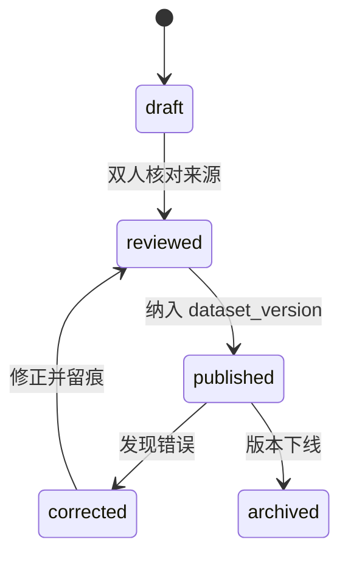

# 数据治理

政治人物数据的第一原则是**可追溯**，第二是**不臆测**。本文件定义数据的来源、精度、
复核、版本与纠错规则；任何进入生产的记录都必须满足这里的最小要求。

## 1. 数据性质与边界

- 只收录**公开政务履历**：姓名、性别、出生年、籍贯、民族、入党/参加工作年月、学历、
  公开任职与免职信息。
- 不收录联系方式、家庭住址、家庭成员、健康状况、非公开评价等个人信息。
- 不根据“惯例”推断某人仍在任；无法确认时保留最后已知状态并标记 `verified=false`。
- 仓库内置数据仅为 UI/查询演示，**不是权威档案**；页面必须常驻数据截止日与免责声明。

## 2. 来源分级

| 级别 | 来源 | 使用规则 |
| --- | --- | --- |
| A | 新华社、人民日报、中国政府网、全国人大公告 | 可直接作为任职依据 |
| B | 省级政府/人大官网、省级党报、中国经济网地方党政领导资料库 | 可作依据，建议与 A 交叉 |
| C | 地方都市报、门户转载、百科 | 仅作线索，必须回溯到 A/B 后才能入库 |
| D | 社交媒体、匿名爆料 | 不采用 |

每条 `tenure` 至少关联 1 个来源；`sources.reliability` 记录级别。来源 URL 失效时
保存 `archive_url`（网页存档）。

## 3. 事实与精度

| 事实 | 字段 | 精度策略 |
| --- | --- | --- |
| 到任 | `start_date` | 有确切日期用 `day`；仅有月份用 `month`（当月 1 日）；仅有年份用 `year`（1 月 1 日） |
| 离任 | `end_date` | 同上；仍在任为 `NULL` |
| 代理 | `is_acting` | “代省长/代市长/代理书记/主持工作”单独成段，不合并进正式任期 |
| 兼任 | `is_concurrent` | 省委书记兼人大主任等，保留但不参与席位排他约束 |
| 当选 | `appointment_type=elected` | 人大会议选举产生 |
| 任命 | `appointment_type=appointed` | 中央决定/人大常委会任命 |
| 代理 | `appointment_type=acting` | 代理期间 |
| 补选 | `appointment_type=co_opted` | 届中补选 |

**月份精度陷阱**：2017-10 的“到任”与“离任”都可能发生在同月。演示数据约定
“后任者取得该月”，前任结束于上月最后一天；生产数据应尽量补全日，避免边界查询
把交接月判给错误的人。

### 3.1 代理 → 正式

典型序列：

```
2016-10  蔡奇 代市长   is_acting=true
2017-01  蔡奇 市长     is_acting=false
2017-05  蔡奇 市委书记 （换岗，市长任期结束）
```

代理段与正式段是两条 `tenure`，共享同一 `position_id`。排他约束只作用于正式记录，
因此不会因为代理段与正式段相邻而报错。

### 3.2 空档

- 席位在两段任职之间存在 > 30 天无记录，UI 显示“空缺 N 天”。
- 空档可能是真实的（无人接任）、也可能是数据缺失。必须通过 `notes` 区分：
  `vacancy_confirmed` / `data_gap`。
- 不允许用“某人继续主持工作”自动填充空档，除非有明确来源。

## 4. 身份消歧

同名官员是最大数据风险。规则：

1. 以 `slug` 作为内部唯一身份；同名不同人不得复用。
2. 入库前校验：出生年、籍贯、民族、学历至少两项与既有记录一致。
3. 跨省调动优先匹配已有 slug，而不是新建。
4. 无法确认时新建并标记 `needs_review`，禁止直接合并。
5. 页面展示出生年/籍贯，帮助用户区分同名者。

## 5. 复核状态机



- `verified=false`：已录入但未完成双人复核。
- `verified=true`：至少一个 A 级来源 + 一次交叉核对。
- 每次修改写 `change_log`（before/after JSONB），保留操作者与时间。
- 发布使用 `dataset_versions`，不直接覆盖历史版本。

## 6. 质量检查清单

导入前必须全部通过：

- [ ] 同一席位正式任职无重叠（数据库排他约束会拒绝）。
- [ ] 同一席位最多一条 `end_date IS NULL` 的正式记录。
- [ ] `end_date >= start_date`。
- [ ] 代理段不与正式段完全重合。
- [ ] 每条记录至少一个 `source_id`。
- [ ] 官员 `slug` 唯一；同名记录有出生年/籍贯区分。
- [ ] `start_precision/end_precision` 与日期精度一致。
- [ ] 跨省调动的前后任期首尾衔接（允许 0–31 天合理空档）。
- [ ] 关键日期（党代会/两会）快照与公开报道抽查一致。

对应 SQL 见 [database.md](database.md#6-导入流水线)。

## 7. 版本与纠错 SLA

| 事件 | 处理 |
| --- | --- |
| 读者指出错误 | 48h 内确认；确认后进入 `corrected` |
| 新任/离任 | 来源发布后 7 天内更新；重大调整 24h 内 |
| 来源链接失效 | 补充 archive_url；不删除历史来源 |
| 数据争议 | 保留双方来源，页面显示“待核实”，不擅自裁决 |

版本号建议 `YYYY.MM`（如 `2025.06`），补丁用 `2025.06.1`。缓存 key 含版本号，
发布即失效。

## 8. 合规与伦理

- 仅处理公开政务信息，符合《个人信息保护法》对已公开个人信息的合理处理边界；
  不进行画像、预测或评价。
- 页面明确“数据仅供研究/演示，不构成权威认定”，并提供纠错入口。
- 不展示涉及国家安全、未公开人事安排的内容。
- 收到权利人合理请求时，及时更正或下架并可追溯。

## 9. 演示数据特别说明

本仓库 `backend/app/data/dataset.json` 与 `infra/initdb/02_seed.sql`：

- 覆盖 2012-11-08 至 2026-10-29（二十届五中全会闭幕日）；
- 月份级精度，部分日期为公开报道推定；
- 全部 `verified=false`；
- 人大/政协的**现任**正职已通过中国经济网省级人物库补齐（含 9 席确认空缺）；2012–2025 历史正职仅完整收录少数省份；
- 官员 bio 仅对部分人物收录，其余为 `null`，UI 显示“待补充”。

**任何生产部署都必须替换该数据集**，并在 `sources` 表中建立逐条来源。
