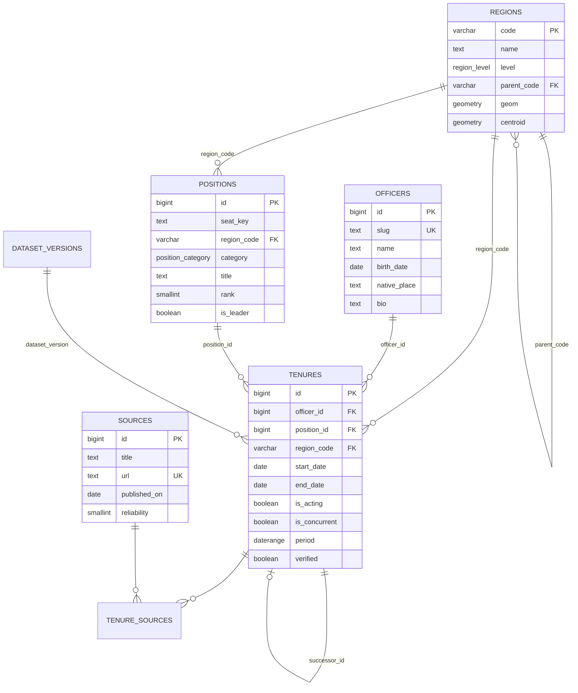

# 数据库设计

PostgreSQL 16 + PostGIS 3.4 + `btree_gist` + `pg_trgm`。完整 DDL 见
[`infra/initdb/01_schema.sql`](../infra/initdb/01_schema.sql)，演示种子见 `02_seed.sql`，
31 省边界见 `03_geometry.sql`。

## 1. ER 模型



## 2. 核心表

### `regions` 行政区划

- 主键 `code` 使用 GB/T 2260（国家 `100000`，省级 6 位，地市 6 位）。
- `geom geometry(MultiPolygon,4326)` + GiST 索引；`centroid` 用于标签/聚合。
- `parent_code` 自引用，已为地市下探预留；`level` 枚举区分 country/province/prefecture/county。

### `officers` 官员

- `slug` 稳定 URL 标识；同名不同人必须人工消歧后分配不同 slug。
- `name` 上建 `pg_trgm` GIN 索引，支撑 `ILIKE '%强%'` 与模糊检索。
- `birth_year` 与 `birth_date` 二选一；历史人物大量只有年份，不强行补日期。

### `positions` 席位注册表

`positions` 不是“某人的任职”，而是“岗位定义”：

| 字段 | 示例 | 说明 |
| --- | --- | --- |
| `seat_key` | `party_secretary` | 稳定的机器标识 |
| `category` | `party` | 党委/人大/政府/政协/其他 |
| `title` | `省委书记` | 展示名 |
| `full_title` | `中共北京市委书记` | 正式全称 |
| `rank` | `1` | 班子内排序（书记 1、省长 2…） |
| `is_leader` | `true` | 是否正职 |
| `parent_position_id` | — | 副书记挂书记下（可选） |

同一省同类班子可以有多个席位（书记、副书记），因此 `UNIQUE` 建在
`(COALESCE(region_code,'000000'), seat_key, valid_from)` 上——中央岗位
`region_code` 为 `NULL`，普通唯一约束会失效。

### `tenures` 任职事实表

**一行 = 一人一岗一段连续任职**，是系统唯一的时间事实来源。

```sql
start_date date NOT NULL,
end_date   date,                 -- NULL = 仍在任
period daterange GENERATED ALWAYS AS
       (daterange(start_date, end_date + 1, '[)')) STORED
```

- 使用**半开区间** `[start, end+1)`，避免“同一天交接”被判定为重叠。
- `title` / `category` / `region_code` 冗余保存写入时的快照：机构改名或区划调整后，旧记录仍能正确展示。
- `start_precision` / `end_precision` 记录日期精度（day/month/year）。演示数据全部为 `month`。
- `appointment_type` 区分 elected / appointed / acting / co_opted / concurrent；`appointment_basis` 记录“省人大常委会第 N 次会议决定”等依据。
- `dataset_version` 外键到 `dataset_versions`，支持按版本回溯与缓存命名空间。
- `verified` 表示人工复核状态；未复核数据在 UI 中带免责声明。
- `rank_level_snapshot` 记录写入时的行政级别（正国级/副国级/正省部级/副省部级…），
  避免岗位级别调整后历史记录被改写。中央政治局委员按副国级、政治局常委按正国级
  展示；同一人在进入政治局前仍显示为正省部级，由读取层按日期动态判定，
  不把“政治局委员”硬编码进每个省级岗位。
- `is_plural` 标记多成员岗位（常委、副职），使其不参与“同一席位不能重叠”的排他约束。
- `start_precision=snapshot` 表示“现任名册快照，起始日待考”，仅用于补齐现任班子，
  不反推历史；UI 显示“现任 · 起始待考”，不计算任期天数。

### `officer_events` 状态事件

任职之外的事实单独成表，避免把“被审查/退休/病逝”硬塞进任职区间：

```sql
officer_events (
  id, officer_id, event_type, event_date, title, description,
  related_tenure_id, source_id, source_url, source_title, verified
)
```

`event_type`：`retired`、`under_investigation`、`expelled_from_party`、
`expelled_from_public_office`、`removed_from_office`、`deceased`、`appointed`、
`transferred`、`other`。

状态由 Service 推导，不在官员主表存“当前状态”，因此可以按任意 `as_of` 查询历史状态。

### `v_officer_directory` 名册视图

一行一个官员，包含当前/最后职务、地区、类别、行政级别、任职起止、状态、
状态日期、来源数。API `/directory` 与人工 SQL 查询共用同一口径。

## 3. 为什么用 GiST 排他约束

同一席位不能同时有两位正式主官。区间重叠是数据库层不变量：

```sql
ALTER TABLE polvis.tenures
  ADD CONSTRAINT tenures_seat_no_overlap
  EXCLUDE USING gist (position_id WITH =, period WITH &&)
  WHERE (is_acting = false AND is_concurrent = false AND is_plural = false);
```

- 代理任职（`is_acting`）、兼任（`is_concurrent`）与多成员岗位（`is_plural`）不受约束；
- 常委、人大/政协副职等多人同时任职的岗位必须设 `is_plural=true`，否则会被误判为重叠。
- 再加一条“同一席位最多一条在任正式记录”的部分唯一索引：

```sql
CREATE UNIQUE INDEX tenures_one_open_uk
  ON polvis.tenures (position_id)
  WHERE end_date IS NULL AND is_acting = false AND is_concurrent = false;
```

- 这比应用层“先查再写”更可靠：并发导入时数据库直接拒绝重叠区间。

> 注意：中央政治局常委这类**多人同时任职**的岗位不是排他席位。本项目为每个
> 人物生成独立 `seat_key`，避免被误判为“同一席位的时间重叠”。

## 4. 索引策略

| 索引 | 用途 |
| --- | --- |
| `tenures_period_gix` GiST(period) | `period @> date` 时点切片 |
| `tenures_region_gix` GiST(region_code, period) | 单省时间切片 |
| `tenures_officer_idx` (officer_id, start_date DESC) | 个人履历 |
| `tenures_open_idx` partial (region_code) WHERE end_date IS NULL | 当前在任 |
| `tenures_category_idx` (category, region_code, start_date DESC) | 指标/班子统计 |
| `regions_geom_gix` GiST(geom) | 点落省、bbox 查询 |
| `officers_name_trgm` GIN(name gin_trgm_ops) | 姓名模糊搜索 |

31 省 × 350 条任职的规模下，顺序扫描也很快；索引是为地市级数据（10 万+）
和并发准备的。冷启动后执行 `ANALYZE polvis.tenures;`。

## 5. 核心查询

### 时点切片

```sql
SELECT region_code, category, seat_key, title, officer_name, start_date,
       duration_days, is_acting
FROM polvis.v_tenure_expanded
WHERE period @> DATE '2017-10-25'
  AND region_code = ANY (ARRAY['110000','310000'])
ORDER BY region_code, category, seat_rank;
```

`v_tenure_expanded` 已把官员、岗位、地区、时长拼好，并用
`COALESCE(upper(period), CURRENT_DATE + 1) - lower(period)` 计算天数。
**注意**：API 的“在任至 as_of”语义在 Service 层重新计算，避免历史快照用到今天的天数。

### 空缺席位

```sql
SELECT p.region_code, p.category, p.title
FROM polvis.positions p
JOIN polvis.regions r ON r.code = p.region_code AND r.level = 'province'
WHERE p.is_leader
  AND NOT EXISTS (
    SELECT 1 FROM polvis.tenures t
    WHERE t.position_id = p.id AND t.period @> DATE '2017-10-25'
  );
```

### 点落省（PostGIS）

```sql
SELECT code, name
FROM polvis.regions
WHERE ST_Contains(geom, ST_SetSRID(ST_Point(121.47, 31.23), 4326));
```

## 6. 导入流水线


建议的 staging 表（未包含在 DDL 中，生产环境增加）：

```sql
CREATE TABLE polvis.import_rows (
  id bigserial PRIMARY KEY,
  batch_id uuid NOT NULL,
  payload jsonb NOT NULL,
  status text NOT NULL DEFAULT 'pending',
  error text
);
```

校验 SQL：

```sql
-- 1) 正式任职区间重叠
SELECT a.id, b.id
FROM polvis.tenures a
JOIN polvis.tenures b
  ON a.position_id = b.position_id AND a.id < b.id
 AND a.period && b.period
WHERE NOT a.is_acting AND NOT b.is_acting;

-- 2) 同一席位多条在任
SELECT position_id, count(*)
FROM polvis.tenures
WHERE end_date IS NULL AND NOT is_acting AND NOT is_concurrent
GROUP BY 1 HAVING count(*) > 1;

-- 3) 结束早于开始
SELECT id FROM polvis.tenures WHERE end_date < start_date;

-- 4) 代理期与正式期完全重合（通常为录入错误）
SELECT t.id
FROM polvis.tenures t
JOIN polvis.tenures s
  ON t.position_id = s.position_id AND t.is_acting AND NOT s.is_acting
 AND t.period @> lower(s.period) AND t.period <@ s.period;
```

## 7. 版本与审计

- `dataset_versions`：`draft → published → archived`；API 只读 `published`。
- `tenures` 上的 `AFTER INSERT/UPDATE/DELETE` 触发器写 `change_log`，保存 before/after JSONB。
- `tenure_sources` 多对多关联公开来源，`sources.reliability` 分 1–3 级。
- 回滚：保留旧版本行，发布新版本；缓存 key 含版本号，无需逐条失效。

## 8. 边界与后续

- **地市级**：`regions` 与 `positions` 已支持 `parent_code`/`level`；需要补 330+ 地市数据与 `?level=prefecture` 参数。
- **历史区划**：`valid_from/valid_to` 已预留，复杂撤并需增加 `region_lineage` 表。
- **全文检索**：官员 bio 可加 `tsvector` + GIN；当前数据量用 `pg_trgm` 足够。
- **分区**：`tenures` 单表在 10 万级无需分区；若扩到县级（百万级），按 `start_date` 范围分区。
